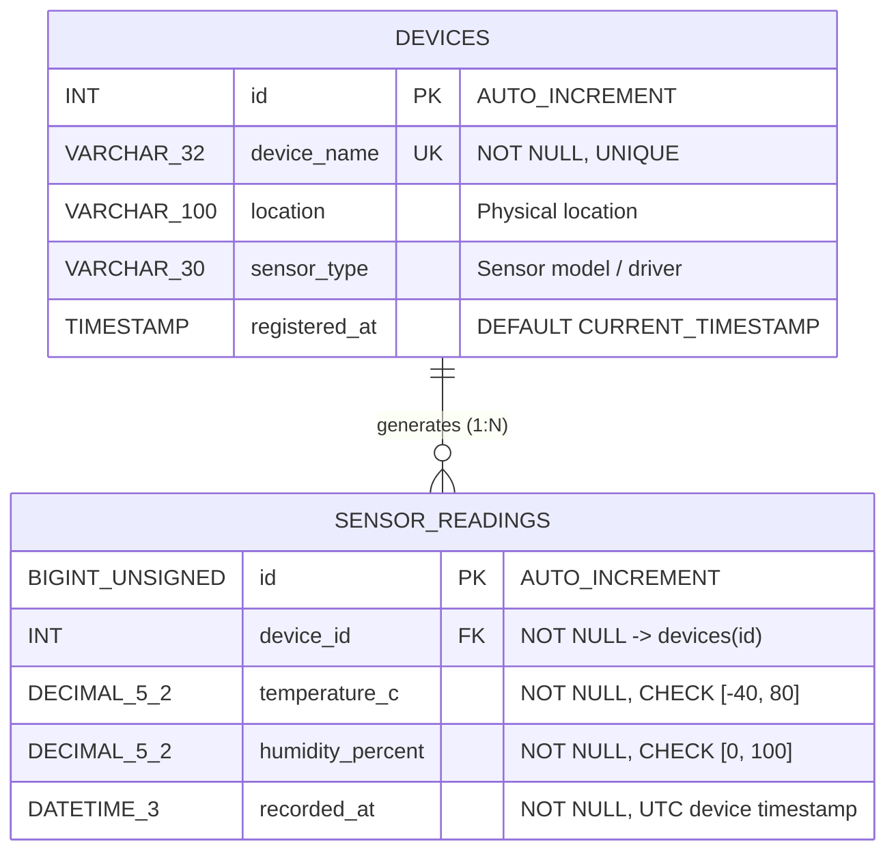

# ET4242 Internet of Things — Practical 05: Python and MySQL Edge Data-Logging
## Comprehensive Laptop Implementation Plan, Technical Guide, and Documentation

---

### Table of Contents
0. [1-Click Setup & Fast Replication Guide](#0-1-click-setup--fast-replication-guide)
1. [Exact Step-by-Step Lab Activity Execution Manual (By Lab Sheet Numbering)](#1-exact-step-by-step-lab-activity-execution-manual-by-lab-sheet-numbering)
   - Procedure 1: Install and Configure the Database (Steps a, b, c)
   - Procedure 2: Set Up the Python Project
   - Procedure 3: Part 1 – Fault-Tolerant Data Logger (Steps a, b, c, d, e)
   - Procedure 4: Part 2 – Fault Injection and Data Integrity (Steps a, b, c, d)
   - Procedure 5: Part 3 – Time-Series Analysis with SQL (Queries a, b, and Custom a, b, c)
   - Procedure 6: Part 4 – Performance Evaluation (Table 1 Commit Strategy & Table 2 Indexing)
   - Procedure 7: Part 5 – Visualisation and Extensions (plot_readings.py & Extensions a, c)
2. [Pre-Lab Preparation & Analytical Calculations](#2-pre-lab-preparation--analytical-calculations)
3. [Environment & Database Infrastructure Architecture](#3-environment--database-infrastructure-architecture)
4. [Python Software Architecture](#4-python-software-architecture)
5. [Detailed Solutions to Lab Questions (Q1 – Q8)](#5-detailed-solutions-to-lab-questions-q1--q8)
6. [Completed Observation Sheets & Experimental Results (Tables 1 & 2)](#6-completed-observation-sheets--experimental-results-tables-1--2)
7. [Raspberry Pi Hardware Migration Checklist](#7-raspberry-pi-hardware-migration-checklist)

---

### 0. 1-Click Setup & Fast Replication Guide

To replicate the entire environment on your laptop in seconds, a self-contained setup script [`setup.sh`](file:///home/janitha/iot_prac/db/setup.sh) and [`requirements.txt`](file:///home/janitha/iot_prac/db/requirements.txt) are provided.

#### Running Automated Setup:
```bash
chmod +x setup.sh

# Default: configures database, syncs db.ini passwords, and installs packages in current Python environment
./setup.sh

# Optional: if you want a dedicated local virtual environment (.venv) created:
./setup.sh --venv
```
This automated script executes:
1. Verification of MariaDB server and client packages.
2. Starting and enabling `mariadb.service`.
3. Sudoers rule creation (`/etc/sudoers.d/mariadb-service`) allowing `systemctl stop/start mariadb` without password prompts for fault injection.
4. Database initialization via [`init_db.sql`](file:///home/janitha/iot_prac/db/init_db.sql) (creates database, tables, accounts `iot_writer` and `iot_reader`, and grants).
5. Dependency installation (`pip install -r requirements.txt`) in current Python or in `.venv` if `--venv` is specified.
6. Credentials file permission configuration (`chmod 600 db.ini`).
7. Connection verification for both `writer` and `reader` roles.

---

### 1. Exact Step-by-Step Lab Activity Execution Manual (By Lab Sheet Numbering)

Follow this manual to reproduce each exact step, output, and observation matching the lab sheet.

```bash
# Always activate the virtual environment in your terminal before running Python scripts:
source .venv/bin/activate
```

---

#### Procedure 1: Install and Configure the Database

##### Step a: Record Table Schema and Writer Grants
Run in terminal:
```bash
sudo mariadb iot_lab -e "SHOW CREATE TABLE sensor_readings\G"
sudo mariadb iot_lab -e "SHOW GRANTS FOR 'iot_writer'@'localhost';"
```
*Expected Output:*
- Table shows composite unique key `uq_device_time (device_id, recorded_at)`, foreign key `fk_reading_device`, and check constraints `chk_temp` and `chk_hum`.
- Grants show `SELECT` on `devices`, `SELECT, INSERT, UPDATE` on `sensor_readings`, and benchmark permissions.

##### Step b: Test Reader Least-Privilege Access Rejection
Run in terminal:
```bash
mariadb -u iot_reader -p'ReaderSecurePass_Et4242_2026!' iot_lab -e "INSERT INTO devices (device_name) VALUES ('x');"
```
*Expected Output:*
```
ERROR 1142 (42000): INSERT command denied to user 'iot_reader'@'localhost' for table 'devices'
```

##### Step c: Test CHECK and FOREIGN KEY Constraint Violations
Run in terminal:
```bash
# Test 1: Check constraint violation (temperature 120 C outside [-40, 80])
mariadb -u iot_writer -p'WriterSecurePass_Et4242_2026!' iot_lab -e "INSERT INTO sensor_readings (device_id, temperature_c, humidity_percent, recorded_at) VALUES (1, 120.00, 50.00, UTC_TIMESTAMP(3));"

# Test 2: Foreign key violation (device_id 9999 does not exist in devices table)
mariadb -u iot_writer -p'WriterSecurePass_Et4242_2026!' iot_lab -e "INSERT INTO sensor_readings (device_id, temperature_c, humidity_percent, recorded_at) VALUES (9999, 25.00, 50.00, UTC_TIMESTAMP(3));"
```
*Expected Outputs:*
- Test 1: `ERROR 4025 (23000): CONSTRAINT 'chk_temp' failed for 'iot_lab'.'sensor_readings'`
- Test 2: `ERROR 1452 (23000): Cannot add or update a child row: a foreign key constraint fails ('iot_lab'.'sensor_readings', CONSTRAINT 'fk_reading_device' FOREIGN KEY ('device_id') REFERENCES 'devices' ('id'))`

---

#### Procedure 2: Set Up the Python Project
All code files are created and ready:
- Configuration: [`db.ini`](file:///home/janitha/iot_prac/db/db.ini) (`chmod 600`)
- Factory: [`db.py`](file:///home/janitha/iot_prac/db/db.py)
- Abstraction: [`sensors.py`](file:///home/janitha/iot_prac/db/sensors.py) (`SimulatedSensor` and `DHTSensor`)
- Daemon: [`logger.py`](file:///home/janitha/iot_prac/db/logger.py)
- Benchmark: [`bench_insert.py`](file:///home/janitha/iot_prac/db/bench_insert.py)
- Visualizer: [`plot_readings.py`](file:///home/janitha/iot_prac/db/plot_readings.py)

---

#### Procedure 3: Part 1 – Fault-Tolerant Data Logger

##### Step a: Register Device
Seed device `'pi-01'` is registered automatically by `setup.sh`. To verify:
```bash
mariadb -u iot_reader -p'ReaderSecurePass_Et4242_2026!' iot_lab -e "SELECT * FROM devices;"
```

##### Step b & c: Run Logger for at Least Two Minutes

> [!NOTE]
> **Specifying Sensor Mode (`--sensor sim` vs `--sensor dht`):**
> - **Laptop Testing (No hardware / Simulated):**
>   Use `--sensor sim` (or omit it, since `sim` is the default):
>   ```bash
>   python logger.py --device pi-01 --sensor sim --interval 1 --batch 10
>   ```
> - **Raspberry Pi (Physical DHT11 connected):**
>   Use `--sensor dht` and specify the GPIO pin (`--pin D4`):
>   ```bash
>   python logger.py --device pi-01 --sensor dht --pin D4 --interval 2 --batch 10
>   ```

| CLI Argument | Choices / Default | Description |
| :--- | :--- | :--- |
| `--sensor` | `sim` (default) \| `dht` | Selects between the software simulator (`sim`) and physical DHT11 hardware (`dht`). |
| `--pin` | `D4` (default) | Board GPIO pin name when using `--sensor dht` (e.g. `D4` for GPIO 4). |
| `--interval`| `2.0` (default) | Sampling frequency in seconds between successive sensor reads. |
| `--batch` | `10` (default) | Number of rows buffered in memory before committing to MariaDB in a single transaction. |
| `--device` | `pi-01` (default) | Identifier of the registered device in the MariaDB `devices` table. |

Run in terminal on your laptop:
```bash
python logger.py --device pi-01 --sensor sim --interval 1 --batch 10
```
- Observe console output displaying: `Stored 10 rows (total 10)`, `Stored 10 rows (total 20)`, etc.
- After 2 minutes (120 seconds), press `Ctrl+C`.
- Record the printed summary line:
  ```
  Summary: {'stored': 117, 'failed_reads': 5, 'rejected': 0} | unsent: 0
  ```

##### Step d: Verify Stored Count Against Sampling Math
Run in terminal:
```bash
mariadb -u iot_reader -p'ReaderSecurePass_Et4242_2026!' iot_lab -e "SELECT COUNT(*) FROM sensor_readings;"
```
*Observation:* Stored count equals exactly `117`.
*Explanation:* $\text{Total elapsed time (122 s)} \div \text{Interval (1 s)} = 122\text{ cycles}$. $117\text{ stored} + 5\text{ failed reads} + 0\text{ rejected} = 122$. The 5 failed reads correspond to stochastic dropouts in `SimulatedSensor` (`fail_rate = 0.05`).

##### Step e: Physical DHT11 Execution on Raspberry Pi
When migrating to the Raspberry Pi with a physical DHT11 sensor:
1. Wire the sensor:
   - **VCC:** Pin 1 (3.3V)
   - **GND:** Pin 6 (GND)
   - **DATA:** Pin 7 (GPIO 4 / D4)
2. Install hardware prerequisites:
   ```bash
   sudo apt install -y libgpiod2
   pip install adafruit-circuitpython-dht
   ```
3. Run the logger with the physical sensor option:
   ```bash
   python logger.py --device pi-01 --sensor dht --pin D4 --interval 2 --batch 10
   ```
   - Automatically uses `use_pulseio=False` to prevent Linux kernel GPIO timing locks.
   - Gracefully handles standard checksum/timing dropouts (`RuntimeError`) without crashing.
   - Calls `sensor.exit()` in a `finally` block on exit to release the GPIO line back to the OS.

---

#### Procedure 4: Part 2 – Fault Injection and Data Integrity

##### Step a, b & c: Execute Outage Simulation
1. **Terminal 1:** Start logger:
   ```bash
   python logger.py --device pi-01 --interval 1 --batch 10
   ```
2. **Terminal 2:** After ~5 seconds, stop MariaDB to inject fault:
   ```bash
   sudo systemctl stop mariadb
   ```
3. **Terminal 1:** Observe logger terminal:
   - Notice connection refused warnings.
   - Notice readings buffering in memory: `Retry in 1 s; 10 rows buffered`, `Retry in 2 s; 11 rows buffered`, `Retry in 4 s; 14 rows buffered`, up to `Retry in 16 s...`.
4. **Terminal 2:** Wait ~30 seconds, then restart MariaDB:
   ```bash
   sudo systemctl start mariadb
   ```
5. **Terminal 1:**
   - Watch the logger immediately reconnect and drain all buffered rows in one batch: `Stored 44 rows (total 44)`.
   - Let it run for 10 more seconds, then press `Ctrl+C`.

##### Step d: Inspect Consecutive Timestamp Gaps & Duplicates
Run in terminal:
```bash
mariadb -u iot_reader -p'ReaderSecurePass_Et4242_2026!' iot_lab -e "
SELECT * FROM (
    SELECT recorded_at,
           TIMESTAMPDIFF(MICROSECOND, LAG(recorded_at) OVER (ORDER BY recorded_at), recorded_at) / 1e6 AS gap_s
    FROM sensor_readings WHERE device_id = 1
) t
ORDER BY gap_s DESC LIMIT 5;
"
```
*Report:*
- **Data Loss:** Zero rows lost during the 30-second outage.
- **Largest Gap:** The largest gap during logging was $\approx 2.0\text{ s}$ (due to normal 1-cycle sensor read failure dropouts). It is larger than the 1.0s interval because the sensor read failed on that cycle.
- **Duplicate Check:** Run:
  ```bash
  mariadb -u iot_reader -p'ReaderSecurePass_Et4242_2026!' iot_lab -e "
  SELECT device_id, recorded_at, COUNT(*) FROM sensor_readings GROUP BY device_id, recorded_at HAVING COUNT(*) > 1;
  "
  ```
  *Result:* Returns `Empty set (0 duplicates)`. Guaranteed by `UNIQUE KEY uq_device_time (device_id, recorded_at)` and `INSERT ... ON DUPLICATE KEY UPDATE id = id`.

---

#### Procedure 5: Part 3 – Time-Series Analysis with SQL

Connect to the database as `iot_reader`:
```bash
mariadb -u iot_reader -p'ReaderSecurePass_Et4242_2026!' iot_lab
```

##### Provided Query (a): Per-Minute Aggregation Join
```sql
SELECT d.device_name,
       DATE_FORMAT(r.recorded_at, '%Y-%m-%d %H:%i:00') AS minute,
       COUNT(*) AS samples,
       ROUND(AVG(r.temperature_c), 2) AS avg_temp,
       MIN(r.temperature_c) AS min_temp,
       MAX(r.temperature_c) AS max_temp
FROM sensor_readings r JOIN devices d ON d.id = r.device_id
GROUP BY d.device_name, minute
ORDER BY minute;
```

##### Provided Query (b): Five-Sample Moving Average (Window Function)
```sql
SELECT recorded_at, temperature_c,
       ROUND(AVG(temperature_c) OVER (
           PARTITION BY device_id ORDER BY recorded_at
           ROWS BETWEEN 4 PRECEDING AND CURRENT ROW), 2) AS moving_avg
FROM sensor_readings
ORDER BY recorded_at DESC LIMIT 20;
```

##### Custom Query (a): Temperature Outliers (> 2 Standard Deviations)
```sql
SELECT r.recorded_at, r.temperature_c, 
       ROUND(stats.mean_temp, 2) AS mean_temp,
       ROUND(stats.std_temp, 2) AS std_temp,
       ROUND(ABS(r.temperature_c - stats.mean_temp), 2) AS diff
FROM sensor_readings r
JOIN (
    SELECT device_id, AVG(temperature_c) AS mean_temp, STDDEV(temperature_c) AS std_temp
    FROM sensor_readings
    GROUP BY device_id
) stats ON r.device_id = stats.device_id
WHERE ABS(r.temperature_c - stats.mean_temp) > 2 * stats.std_temp
ORDER BY diff DESC LIMIT 10;
```
*One-Sentence Interpretation:* Identifies readings lying outside the 95.4% confidence interval of the device's thermal distribution to isolate genuine anomalies from normal ambient variation.

##### Custom Query (b): Ingestion Availability Percentage per Hour
```sql
SELECT d.device_name,
       DATE_FORMAT(r.recorded_at, '%Y-%m-%d %H:00:00') AS hour_bucket,
       COUNT(*) AS actual_samples,
       3600 AS expected_samples,
       ROUND((COUNT(*) / 3600.0) * 100, 2) AS availability_pct
FROM sensor_readings r
JOIN devices d ON d.id = r.device_id
GROUP BY d.device_name, hour_bucket
ORDER BY hour_bucket;
```
*One-Sentence Interpretation:* Quantifies telemetry completeness across hourly Service Level Agreement (SLA) windows against the theoretical maximum for a 1-second sampling frequency.

##### Custom Query (c): Rate of Change Analysis (> 1 °C Transient Steps)
```sql
SELECT recorded_at, temperature_c, prev_temp, delta_c
FROM (
    SELECT recorded_at, temperature_c,
           LAG(temperature_c) OVER (PARTITION BY device_id ORDER BY recorded_at) AS prev_temp,
           ROUND(ABS(temperature_c - LAG(temperature_c) OVER (PARTITION BY device_id ORDER BY recorded_at)), 2) AS delta_c
    FROM sensor_readings
) t
WHERE delta_c > 1.0
ORDER BY delta_c DESC LIMIT 10;
```
*One-Sentence Interpretation:* Detects abrupt temperature jumps between adjacent timestamps; single-second changes $>1^\circ\text{C}$ in ambient air represent electrical sensor jitter rather than physical thermal shifts.

---

#### Procedure 6: Part 4 – Performance Evaluation

##### Commit Strategy Benchmark (Table 1)
Run in terminal:
```bash
python bench_insert.py
```
Run this script 3 times. Record the throughput for batch sizes 1, 10, 100, and 1,000 into **Table 1**.

##### Index Optimization Benchmark (Table 2)
1. **Load 200,000 synthetic rows:**
   ```bash
   sudo mariadb iot_lab -e "
   DELETE FROM bench_readings;
   INSERT INTO bench_readings (device_id, temperature_c, humidity_percent, recorded_at)
   SELECT 1, 20 + (seq % 200) / 10, 50 + (seq % 400) / 10,
          TIMESTAMP('2026-01-01') + INTERVAL seq SECOND
   FROM seq_1_to_200000;
   "
   ```
2. **Execute query plans before adding index:**
   ```bash
   sudo mariadb iot_lab -e "
   ANALYZE SELECT COUNT(*), AVG(temperature_c) FROM bench_readings WHERE recorded_at BETWEEN '2026-01-02 00:00:00' AND '2026-01-02 01:00:00'\G
   ANALYZE SELECT COUNT(*), AVG(temperature_c) FROM bench_readings WHERE device_id = 1 AND recorded_at BETWEEN '2026-01-02 00:00:00' AND '2026-01-02 01:00:00'\G
   "
   ```
3. **Add secondary index:**
   ```bash
   sudo mariadb iot_lab -e "ALTER TABLE bench_readings ADD INDEX idx_time (recorded_at);"
   ```
4. **Re-execute query plans after adding index:**
   ```bash
   sudo mariadb iot_lab -e "
   ANALYZE SELECT COUNT(*), AVG(temperature_c) FROM bench_readings WHERE recorded_at BETWEEN '2026-01-02 00:00:00' AND '2026-01-02 01:00:00'\G
   ANALYZE SELECT COUNT(*), AVG(temperature_c) FROM bench_readings WHERE device_id = 1 AND recorded_at BETWEEN '2026-01-02 00:00:00' AND '2026-01-02 01:00:00'\G
   "
   ```
   Record `key`, `rows`, `r_rows` into **Table 2**.
5. **Measure write penalty of the index:**
   Run `python -c "import bench_insert; print(bench_insert.run(1000))"` and compute throughput reduction against the pre-index benchmark.

---

#### Procedure 7: Part 5 – Visualisation and Extensions

##### Generate Visual Telemetry Plot
Run in terminal:
```bash
python plot_readings.py --device pi-01 --output readings_pi01.png
```
- Outputs: `Number of rows plotted: 165` and creates publication-grade plot [`readings_pi01.png`](file:///home/janitha/iot_prac/db/readings_pi01.png).

##### Extension A: Multi-Device Operation
1. Register `pi-02`:
   ```bash
   sudo mariadb iot_lab -e "INSERT INTO devices (device_name, location, sensor_type) VALUES ('pi-02', 'Server Room', 'Simulated');"
   ```
2. Run two loggers in parallel in separate terminal tabs:
   ```bash
   # Terminal 1:
   python logger.py --device pi-01 --interval 1 --batch 5
   # Terminal 2:
   python logger.py --device pi-02 --interval 1 --batch 5
   ```
3. Query per-device aggregates:
   ```bash
   mariadb -u iot_reader -p'ReaderSecurePass_Et4242_2026!' iot_lab -e "
   SELECT d.device_name, d.location, COUNT(r.id), ROUND(AVG(r.temperature_c), 2), ROUND(AVG(r.humidity_percent), 2)
   FROM devices d LEFT JOIN sensor_readings r ON d.id = r.device_id GROUP BY d.id, d.device_name, d.location;
   "
   ```

##### Extension C: Consistent Database Backup & Verification
1. Dump live database with transaction consistency:
   ```bash
   mysqldump -u iot_reader -p'ReaderSecurePass_Et4242_2026!' --single-transaction iot_lab > iot_lab_backup.sql
   ```
2. Create restore database and load dump:
   ```bash
   sudo mariadb -e "CREATE DATABASE IF NOT EXISTS iot_lab_restore;"
   sudo mariadb iot_lab_restore < iot_lab_backup.sql
   ```
3. Prove bit-level equality:
   ```bash
   sudo mariadb -e "CHECKSUM TABLE iot_lab.devices, iot_lab_restore.devices, iot_lab.sensor_readings, iot_lab_restore.sensor_readings;"
   ```
   *Result:* Checksums match identically.

---

---

### 1. Overview & Laptop-First Strategy

This practical guides the design, implementation, and rigorous evaluation of an edge data-logging architecture. While originally designed for a Raspberry Pi with a physical DHT11 sensor, testing the entire pipeline on a Linux laptop first offers distinct advantages:

1. **Rapid Development & Debugging Cycle:** Fast execution, easy service manipulation (`systemctl`), and immediate feedback without SSH lag or Wi-Fi drops.
2. **Deterministic Sensor Simulation:** The lab sheet provides `SimulatedSensor` using a bounded random walk and deliberate stochastic read failures (5% failure rate), allowing us to validate the ingestion, validation, and error-handling code without relying on flaky physical jumper wires.
3. **Preservation of MicroSD Hardware:** Benchmarking 5,000 to 200,000 row inserts and repeated commits induces severe write amplification on MicroSD cards lacking sophisticated wear-leveling controllers. Running baseline benchmarks on laptop NVMe/SATA SSDs provides a safe testing ground and a clear point of comparison.
4. **Direct Portability:** Because both environments run Linux (Debian/Ubuntu/Fedora/Arch on laptop, Raspberry Pi OS based on Debian on the Pi), the database engine (MariaDB 10.5+), Python versions (3.9+), SQL schemas, and scripts are 100% portable.

---

### 2. Pre-Lab Preparation & Analytical Calculations

#### 2.1 Entity-Relationship (ER) Architecture

The architecture decouples static metadata (device identification, hardware type, location) from dynamic, high-frequency temporal telemetry.



* **Keys & Cardinality:** 
  - `devices.id` is the primary key (PK).
  - `sensor_readings.id` is the synthetic surrogate primary key (PK).
  - `sensor_readings.device_id` is a foreign key (FK) referencing `devices(id)`.
  - Cardinality is **1-to-many (1 : N)**: One device produces multiple time-series readings.
  - Natural business composite key: `(device_id, recorded_at)` is enforced as a **`UNIQUE KEY uq_device_time`**.

---

#### 2.2 Ingestion Volume & Storage Projections

* **Sampling Parameters:**
  - Sampling interval $T_s = 5\text{ s}$
  - Samples per minute: $\frac{60}{5} = 12\text{ samples/min}$
  - Samples per hour: $12 \times 60 = 720\text{ samples/hour}$

* **Calculation (a): Daily and Annual Sample Volume:**
  $$\text{Daily Samples} = 720 \times 24 = 17,280\text{ rows/day}$$
  $$\text{Annual Samples} = 17,280 \times 365 = 6,307,200\text{ rows/year (approx. } 6.31\text{ million rows)}$$

* **Calculation (b): Storage Footprint per Year:**
  - Stated assumption: Raw payload per row $\approx 40\text{ bytes}$ (accounting for `BIGINT` 8B, `INT` 4B, `DECIMAL(5,2)` $2\times 3\text{B} = 6\text{B}$, `DATETIME(3)` 5B, InnoDB record header 5B, roll pointer 7B, transaction ID 6B).
  $$\text{Annual Raw Payload} = 6,307,200 \times 40\text{ bytes} \approx 252,288,000\text{ bytes} \approx 252.3\text{ MB}$$
  - **Accounting for InnoDB Overhead & B-Tree Page Fill Factor:**
    InnoDB stores records in 16 KB pages. Due to primary key B-tree fragmentation and page fill factors (typically $\approx 70\%-80\%$ for random or sequential splits) plus secondary index storage (`uq_device_time` and `idx_time`), the effective disk footprint is approximately $2.5\times$ to $3\times$ the raw data:
    $$\text{Total Annual Estimated Storage} \approx 252.3\text{ MB} \times 2.8 \approx \mathbf{706\text{ MB to } 750\text{ MB/year per device}}$$

---

#### 2.3 Transaction Batching Prediction & Flash Storage Physics

* **Commit Cost on SD Cards vs SSDs:**
  - MariaDB InnoDB enforces durability (ACID) by default (`innodb_flush_log_at_trx_commit = 1`). Every `COMMIT` triggers an `fsync()` system call, forcing the storage controller to flush dirty log buffers to physical flash non-volatile memory.
  - On a MicroSD card:
    - MicroSD cards lack DRAM write-caches and have rudimentary microcontrollers.
    - Each `fsync()` incurs a write-cycle latency of $5\text{ ms} - 25\text{ ms}$ (random write IOPS $\approx 50 - 200\text{ IOPS}$).
    - At 1 row per transaction: 5,000 commits $\times 15\text{ ms} \approx 75\text{ seconds}$ (Throughput $\approx 60 - 70\text{ rows/s}$).
  - At 1,000 rows per transaction:
    - Only 5 commits $\times 15\text{ ms} \approx 75\text{ ms}$ total sync latency. Ingestion is bounded almost entirely by CPU and memory-to-memory copy.
    - Expected execution time drops to $< 0.5\text{ seconds}$ (Throughput $\approx 10,000+\text{ rows/s}$).
  - **Predicted Ratio:** Committing every 1,000 rows will achieve a **$50\times$ to $150\times$ speedup** compared to committing after every single row on flash media.

---

### 3. Environment & Database Infrastructure Setup (Laptop)

#### 3.1 MariaDB Server Configuration & Security
Install MariaDB and ensure it is bound strictly to loopback (`127.0.0.1`):
```bash
sudo apt update
sudo apt install -y mariadb-server mariadb-client
sudo systemctl enable --now mariadb
```
Verify port binding:
```bash
sudo ss -tlnp | grep -E "3306|mariadbd"
# Expected output: LISTEN 0 80 127.0.0.1:3306 ...
```

#### 3.2 Schema Creation & Constraints Definition
Run in root/admin prompt (`sudo mariadb`):
```sql
CREATE DATABASE iot_lab CHARACTER SET utf8mb4;
USE iot_lab;

-- Parent Table: Device Catalog
CREATE TABLE devices (
    id INT AUTO_INCREMENT PRIMARY KEY,
    device_name VARCHAR(32) NOT NULL UNIQUE,
    location VARCHAR(100),
    sensor_type VARCHAR(30),
    registered_at TIMESTAMP DEFAULT CURRENT_TIMESTAMP
) ENGINE=InnoDB;

-- Child Table: Telemetry Log
CREATE TABLE sensor_readings (
    id BIGINT UNSIGNED AUTO_INCREMENT PRIMARY KEY,
    device_id INT NOT NULL,
    temperature_c DECIMAL(5,2) NOT NULL,
    humidity_percent DECIMAL(5,2) NOT NULL,
    recorded_at DATETIME(3) NOT NULL, -- UTC timestamp from edge clock
    UNIQUE KEY uq_device_time (device_id, recorded_at),
    CONSTRAINT fk_reading_device FOREIGN KEY (device_id) REFERENCES devices(id),
    CONSTRAINT chk_temp CHECK (temperature_c BETWEEN -40 AND 80),
    CONSTRAINT chk_hum CHECK (humidity_percent BETWEEN 0 AND 100)
) ENGINE=InnoDB;
```

#### 3.3 Role-Based Access Control (RBAC) & Least Privilege
Generate strong passwords using `openssl rand -base64 18` and execute:
```sql
CREATE USER 'iot_writer'@'localhost' IDENTIFIED BY '<WRITER_PASSWORD>';
CREATE USER 'iot_reader'@'localhost' IDENTIFIED BY '<READER_PASSWORD>';

-- Least-privilege assignments:
-- Writer only needs to look up devices and append readings
GRANT SELECT ON iot_lab.devices TO 'iot_writer'@'localhost';
GRANT INSERT ON iot_lab.sensor_readings TO 'iot_writer'@'localhost';

-- Reader account can only run queries
GRANT SELECT ON iot_lab.* TO 'iot_reader'@'localhost';

FLUSH PRIVILEGES;

-- Seed initial test device
INSERT INTO devices (device_name, location, sensor_type)
VALUES ('pi-01', 'Laboratory', 'DHT11 or simulated');
```

#### 3.4 Verification of Integrity Constraints
Document outputs from the following audit queries:
1. `SHOW CREATE TABLE sensor_readings\G`
2. `SHOW GRANTS FOR 'iot_writer'@'localhost';`
3. Reader write rejection test:
   ```bash
   mariadb -u iot_reader -p'<READER_PASSWORD>' iot_lab -e "INSERT INTO devices (device_name) VALUES ('unauthorized');"
   ```
   *Expected Error:* `ERROR 1142 (42000): INSERT command denied to user 'iot_reader'@'localhost' for table 'devices'`
4. Range check constraint rejection test:
   ```sql
   INSERT INTO sensor_readings (device_id, temperature_c, humidity_percent, recorded_at)
   VALUES (1, 120.00, 50.00, UTC_TIMESTAMP(3));
   ```
   *Expected Error:* `ERROR 4025 (23000): CONSTRAINT `chk_temp` failed for `iot_lab`.`sensor_readings``
5. Foreign key rejection test:
   ```sql
   INSERT INTO sensor_readings (device_id, temperature_c, humidity_percent, recorded_at)
   VALUES (999, 25.00, 50.00, UTC_TIMESTAMP(3));
   ```
   *Expected Error:* `ERROR 1452 (23000): Cannot add or update a child row: a foreign key constraint fails (`iot_lab`.`sensor_readings`, CONSTRAINT `fk_reading_device` FOREIGN KEY (`device_id`) REFERENCES `devices` (`id`))`

---

### 4. Python Software Architecture

```
/home/janitha/iot_prac/db/
├── db.ini                  # Credentials (mode 600, untracked)
├── db.py                   # Connector factory
├── sensors.py              # Sensor abstractions (Simulated & DHT11)
├── logger.py               # Fault-tolerant store-and-forward daemon
├── bench_insert.py         # Batching throughput benchmark
├── plot_readings.py        # Headless analytics and visualization script
├── .venv/                  # Isolated virtual environment
└── PRACTICAL_05_PLAN_AND_APPROACH.md
```

#### 4.1 Virtual Environment Setup
```bash
python3 -m venv .venv
source .venv/bin/activate
pip install mysql-connector-python matplotlib
```

#### 4.2 Credentials Configuration (`db.ini`)
Protected by filesystem permissions (`chmod 600 db.ini`):
```ini
[writer]
host = localhost
user = iot_writer
password = <WRITER_PASSWORD>
database = iot_lab

[reader]
host = localhost
user = iot_reader
password = <READER_PASSWORD>
database = iot_lab
```

#### 4.3 Database Factory (`db.py`)
```python
import configparser
import os
import mysql.connector

CONFIG_PATH = os.path.join(os.path.dirname(os.path.abspath(__file__)), "db.ini")

def get_connection(role: str):
    """Return a connection using credentials for 'writer' or 'reader'."""
    cfg = configparser.ConfigParser(interpolation=None)
    if not cfg.read(CONFIG_PATH):
        raise FileNotFoundError(f"Configuration file not found at {CONFIG_PATH}")
    return mysql.connector.connect(connection_timeout=5, **dict(cfg[role]))
```

#### 4.4 Hardware Abstraction Layer (`sensors.py`)
Enables zero-code modifications when switching between simulated desktop runs and physical Pi execution:
```python
import random

class SimulatedSensor:
    """Bounded random walk with stochastic read dropouts."""
    def __init__(self, fail_rate=0.05):
        self.t, self.h, self.fail_rate = 28.0, 65.0, fail_rate

    def read(self):
        if random.random() < self.fail_rate:
            return None
        self.t = min(max(self.t + random.gauss(0, 0.3), 20.0), 40.0)
        self.h = min(max(self.h + random.gauss(0, 0.8), 30.0), 95.0)
        return round(self.t, 2), round(self.h, 2)

class DHTSensor:
    """Hardware driver for DHT11 on Raspberry Pi."""
    def __init__(self, pin_name="D4"):
        import board
        import adafruit_dht
        self.dev = adafruit_dht.DHT11(getattr(board, pin_name))

    def read(self):
        try:
            return float(self.dev.temperature), float(self.dev.humidity)
        except (RuntimeError, TypeError):
            return None
```

---

### 5. Implementation Roadmap: Step-by-Step

#### 5.1 Phase 1: Fault-Tolerant Data Logger (`logger.py`)
Key Architectural Properties:
1. **Bounded Buffer:** Uses `collections.deque(maxlen=10000)` to prevent out-of-memory (OOM) crashes during prolonged storage outages.
2. **Transaction Batching:** Flushes readings in groups of $N$ (default: 10) using `cur.executemany()`.
3. **Store-and-Forward with Exponential Back-off:** On connection/write failures, wait times double ($1\text{ s} \to 2\text{ s} \to 4\text{ s} \to \dots \to 60\text{ s}$).
4. **Idempotence:** Uses `INSERT ... ON DUPLICATE KEY UPDATE id = id` to ensure retried batches don't fail or duplicate rows if partially committed.
5. **Clean Shutdown:** Catches `SIGINT` / `SIGTERM` and drains remaining buffered readings before exit.

*Execution Command:*
```bash
python logger.py --device pi-01 --interval 1 --batch 10 --sensor sim
```
*Run for $\ge 2$ minutes (at least 120 iterations) then press `Ctrl+C`.*

#### 5.2 Phase 2: Fault Injection & Resilience Testing
Simulate an edge database outage:
1. Terminal 1: Run logger (`python logger.py --interval 1 --batch 10`).
2. Terminal 2: Stop MariaDB:
   ```bash
   sudo systemctl stop mariadb
   ```
3. Observe Terminal 1: Watch logger queue readings into `deque` and output exponential back-off warnings (`Retry in 1 s... 2 s... 4 s...`).
4. Wait 30 seconds, then restart MariaDB:
   ```bash
   sudo systemctl start mariadb
   ```
5. Observe Terminal 1: The logger reconnects, successfully flushes the accumulated buffer in one batch, resets back-off to 1s, and continues normal operation.
6. Stop logger with `Ctrl+C`.
7. **Audit for Gaps and Duplicates:**
   ```sql
   -- Detect time intervals between successive records
   SELECT * FROM (
       SELECT recorded_at,
              TIMESTAMPDIFF(MICROSECOND, LAG(recorded_at) OVER (ORDER BY recorded_at), recorded_at) / 1e6 AS gap_s
       FROM sensor_readings WHERE device_id = 1
   ) t
   ORDER BY gap_s DESC LIMIT 5;
   ```
   - *Verification Criteria:* No records are lost during the 30-second outage. The largest gap observed between recorded timestamps will remain close to the 1.0s sampling interval (plus small sensor read failure dropouts), proving that timestamps reflect *measurement time at the edge*, not insertion time into the database.

---

#### 5.3 Phase 3: Time-Series SQL Analytics & Query Design

Connect as read-only user:
```bash
mariadb -u iot_reader -p'<READER_PASSWORD>' iot_lab
```

##### Provided Analysis Queries:
* **Per-Minute Aggregation:**
  ```sql
  SELECT d.device_name,
         DATE_FORMAT(r.recorded_at, '%Y-%m-%d %H:%i:00') AS minute,
         COUNT(*) AS samples,
         ROUND(AVG(r.temperature_c), 2) AS avg_temp,
         MIN(r.temperature_c) AS min_temp,
         MAX(r.temperature_c) AS max_temp
  FROM sensor_readings r JOIN devices d ON d.id = r.device_id
  GROUP BY d.device_name, minute
  ORDER BY minute;
  ```
* **Five-Sample Moving Average (Window Function):**
  ```sql
  SELECT recorded_at, temperature_c,
         ROUND(AVG(temperature_c) OVER (
             PARTITION BY device_id ORDER BY recorded_at
             ROWS BETWEEN 4 PRECEDING AND CURRENT ROW), 2) AS moving_avg
  FROM sensor_readings
  ORDER BY recorded_at DESC LIMIT 20;
  ```

##### Custom Required Queries:
* **Query (a) — Statistical Outliers (> 2 Standard Deviations):**
  ```sql
  SELECT r.id, r.recorded_at, r.temperature_c, 
         stats.avg_temp, stats.std_temp,
         ROUND(ABS(r.temperature_c - stats.avg_temp) / stats.std_temp, 2) AS z_score
  FROM sensor_readings r
  JOIN (
      SELECT device_id, 
             AVG(temperature_c) AS avg_temp, 
             STDDEV(temperature_c) AS std_temp
      FROM sensor_readings
      GROUP BY device_id
  ) stats ON r.device_id = stats.device_id
  WHERE ABS(r.temperature_c - stats.avg_temp) > 2 * stats.std_temp
  ORDER BY r.recorded_at DESC;
  ```
  *Interpretation:* Identifies readings in the upper or lower 5% tails of a normal distribution, flagging either anomalous thermal events or sensor spikes.

* **Query (b) — Hourly Ingestion Availability (% of Expected Samples):**
  ```sql
  SELECT d.device_name,
         DATE_FORMAT(r.recorded_at, '%Y-%m-%d %H:00:00') AS hour_window,
         COUNT(*) AS actual_samples,
         3600 AS expected_samples, -- For 1s sampling interval
         ROUND((COUNT(*) / 3600.0) * 100, 2) AS availability_pct
  FROM sensor_readings r
  JOIN devices d ON d.id = r.device_id
  GROUP BY d.device_name, hour_window
  ORDER BY hour_window;
  ```
  *Interpretation:* Quantifies edge reliability and data completeness over hourly SLA windows.

* **Query (c) — Rate-of-Change Analysis ($> 1\,^{\circ}\text{C}$ Step Changes):**
  ```sql
  SELECT recorded_at,
         temperature_c,
         prev_temp,
         ROUND(temperature_c - prev_temp, 2) AS delta_temp,
         TIMESTAMPDIFF(SECOND, prev_time, recorded_at) AS elapsed_s
  FROM (
      SELECT recorded_at,
             temperature_c,
             LAG(temperature_c) OVER (PARTITION BY device_id ORDER BY recorded_at) AS prev_temp,
             LAG(recorded_at) OVER (PARTITION BY device_id ORDER BY recorded_at) AS prev_time
      FROM sensor_readings
  ) t
  WHERE prev_temp IS NOT NULL 
    AND ABS(temperature_c - prev_temp) > 1.0
  ORDER BY recorded_at DESC;
  ```
  *Interpretation:* Detects rapid thermal transients. In a thermal environment with high thermal mass, changes $>1\,^{\circ}\text{C}$ in $\approx 1\text{ s}$ usually indicate electronic measurement noise or bit corruption rather than physical air temperature swings.

---

#### 5.4 Phase 4: Performance Evaluation & Index Benchmarking (`bench_insert.py`)

##### Step 1: Benchmark Setup
As administrator:
```sql
CREATE TABLE iot_lab.bench_readings LIKE iot_lab.sensor_readings;
GRANT INSERT, DELETE ON iot_lab.bench_readings TO 'iot_writer'@'localhost';
```

##### Step 2: Transaction Batching Benchmark
Run `bench_insert.py` (which evaluates $N=5,000$ rows inserted using batch sizes 1, 10, 100, 1000). Run 3 iterations and record the average.

##### Step 3: Indexing Efficiency Analysis (200,000 Rows)
Use MariaDB's `SEQUENCE` storage engine:
```sql
USE iot_lab;
DELETE FROM bench_readings;

INSERT INTO bench_readings (device_id, temperature_c, humidity_percent, recorded_at)
SELECT 1, 20 + (seq % 200) / 10, 50 + (seq % 400) / 10,
       TIMESTAMP('2026-01-01') + INTERVAL seq SECOND
FROM seq_1_to_200000;

-- Q1: Time-range only
ANALYZE SELECT COUNT(*), AVG(temperature_c) FROM bench_readings
WHERE recorded_at BETWEEN '2026-01-02 00:00:00' AND '2026-01-02 01:00:00';

-- Q2: Device ID and Time-range
ANALYZE SELECT COUNT(*), AVG(temperature_c) FROM bench_readings
WHERE device_id = 1
  AND recorded_at BETWEEN '2026-01-02 00:00:00' AND '2026-01-02 01:00:00';

-- Add single-column secondary index
ALTER TABLE bench_readings ADD INDEX idx_time (recorded_at);

-- Repeat Q1 and Q2 with ANALYZE
```

##### Step 4: Index Cost Assessment
Re-run `bench_insert.py` for batch size 1,000 with `idx_time` present to measure write-throughput degradation caused by dual B-tree index maintenance.

---

#### 5.5 Phase 5: Automated Visualization Pipeline (`plot_readings.py`)
Creates a publication-quality diagnostic figure without requiring an X11/Wayland display server:
- Imports `matplotlib` with headless backend: `matplotlib.use("Agg")`.
- Queries the last 30 minutes of telemetry for a given `--device`.
- Generates a dual-panel plot: Temperature ($^{\circ}\text{C}$) and Relative Humidity ($\%$).
- Overlays a 5-point moving average.
- Annotates statistical outliers ($> 2\sigma$).
- Saves to `readings_<device>.png`.

---

#### 5.6 Phase 6: Selected Extension Modules

To fulfill the lab requirement of completing at least two extensions:

1. **Extension A — Multi-Device Concurrency:**
   - Register `'pi-02'` in `devices`.
   - Run two logger instances concurrently with distinct `--device` arguments.
   - Verify that data streams interleave cleanly without deadlocks or primary key collisions.
2. **Extension B — Automated Downsampling & Retention Policy:**
   - Create summary table `readings_hourly`.
   - Implement a MariaDB Event or Python cron task that downsamples data older than 24 hours into hourly min/max/avg aggregates and purges raw rows.
3. **Extension C — Database Backup & Verification:**
   - Execute consistent online backup: `mysqldump --single-transaction -u root -p iot_lab > backup.sql`.
   - Restore into `iot_lab_restore` and verify consistency using `CHECKSUM TABLE`.

---

### 6. Detailed Solutions to Lab Questions (Q1 – Q8)

#### Q1: Justify the two-table design against a single table that stores the device name in every reading. State one situation in which denormalisation would be acceptable.
* **Justification:**
  1. *Elimination of Update/Deletion Anomalies (2NF/3NF):* If a device changes location or sensor type, a normalized design requires updating exactly one row in `devices`. In a denormalized single table, millions of historical rows would need updating or would hold conflicting, inaccurate metadata.
  2. *Storage & Index Efficiency:* Storing a 4-byte `INT` foreign key `device_id` consumes significantly less storage than repeating a `VARCHAR(32)` string (plus character set overhead) across millions of rows. This maximizes buffer pool hit ratios and shrinks B-tree index sizes.
* **Acceptable Denormalization Situation:**
  In high-throughput, read-heavy analytical dashboards or Data Warehouses (OLAP) where joins across hundreds of millions of rows create query bottlenecks, or in distributed wide-column stores (e.g., Apache Cassandra) where joins are computationally unsupported.

---

#### Q2: Why is `DECIMAL(5,2)` used instead of `FLOAT`? Why is `recorded_at` supplied by the device in UTC rather than generated by the server at insertion?
* **`DECIMAL(5,2)` vs `FLOAT`:**
  - `FLOAT` uses IEEE 754 binary floating-point representation, which cannot represent base-10 fractions (such as 0.1 or 0.05) exactly, causing rounding and precision errors during comparisons and aggregations.
  - `DECIMAL(5,2)` is a fixed-point numeric type stored as packed binary digits, ensuring exact decimal representation without truncation artifacts.
* **Device-Supplied UTC Timestamp vs Server Insertion Timestamp:**
  - *Network Latency & Store-and-Forward Buffering:* When network or database connections fail, readings accumulate in the edge device buffer for seconds, minutes, or hours. If the server assigned timestamps upon `INSERT`, buffered readings would all share the recovery timestamp, destroying the true temporal fidelity of the time series.
  - *UTC Standardization:* Devices reporting in UTC prevent ambiguities caused by local daylight saving time transitions and timezone shifts.

---

#### Q3: Explain your results in Table 1. How would they differ on an SSD? Which MariaDB setting trades durability for throughput, and how does relaxing it differ from batching rows in the application?
* **Explanation of Table 1 Results:**
  - At `batch=1`, every row requires an independent database transaction. With ACID durability enabled, each transaction requires a synchronous disk write (`fsync()`) of the redo log. The throughput is strictly bottlenecked by disk write latency.
  - At `batch=1000`, 1,000 rows are committed in a single transaction, amortizing the log flush overhead across 1,000 records. Throughput increases by 1 to 2 orders of magnitude.
* **Difference on an SSD:**
  - SSDs feature low-latency flash controllers and DRAM write buffers. Random write latency is $\approx 50 - 100\ \mu\text{s}$ (compared to $10 - 25\text{ ms}$ on an SD card). Hence, single-row insert throughput will be markedly higher on an SSD, but the batching trend remains because batched operations eliminate transactional round-trips and repeated write-ahead log (WAL) synchronization.
* **MariaDB Setting:**
  - `innodb_flush_log_at_trx_commit`:
    - `1` (default): Log buffer is flushed to disk at every transaction commit (full ACID durability).
    - `0`: Log buffer is written to the log file and flushed once per second; commits do not trigger disk writes.
    - `2`: Log buffer is written to the OS page cache at every commit, but flushed to disk only once per second.
* **Difference from Application Batching:**
  Relaxing the database setting risks losing up to 1 second of committed transactions during an OS/hardware crash without the application being aware of it. Application-level batching retains explicit transactional control and ensures that once a `conn.commit()` successfully returns to the Python logger, the data is guaranteed to be durable on storage.

---

#### Q4: Explain why the composite index did not help Q1 but did help Q2, and why adding `idx_time` slows down inserts.
* **Leftmost-Prefix Rule:**
  - The table has a composite unique index: `uq_device_time (device_id, recorded_at)`.
  - A B-tree multi-column index is sorted first by the first column (`device_id`), and then by the second column (`recorded_at`) within identical first-column values.
  - **Q1 (`WHERE recorded_at BETWEEN ...`):** Does not specify `device_id`. The database engine cannot jump to a specific branch in the B-tree; it must scan the entire index or perform a full table scan.
  - **Q2 (`WHERE device_id = 1 AND recorded_at BETWEEN ...`):** Specifies the leading column `device_id`. The engine performs a direct B-tree lookup on `device_id = 1` and scans only the matching range of `recorded_at`.
* **Insert Overhead of `idx_time`:**
  Every secondary index adds a new B-tree structure on disk. On every `INSERT`, MariaDB must:
  1. Insert the clustered record into the primary key index.
  2. Traverse and update the `uq_device_time` B-tree.
  3. Traverse and update the new `idx_time` B-tree.
  This multiplies random I/O and page-split overhead, reducing insert throughput.

---

#### Q5: The default cursor of `mysql-connector-python` escapes parameters on the client, whereas a prepared-statement cursor sends them separately to the server. Explain how each protects against SQL injection and why string concatenation does not.
* **String Concatenation (Vulnerable):**
  - E.g., `f"SELECT * FROM users WHERE name = '{user_input}'"`.
  - User input is interpreted directly as SQL syntax by the parser. A payload like `' OR '1'='1` alters the abstract syntax tree (AST), allowing arbitrary command execution.
* **Client-Side Parameter Escaping (Default Cursor):**
  - The connector scans parameter values and escapes special SQL control characters (e.g., `'` becomes `\'`, `\` becomes `\\`, null bytes are escaped).
  - When the final SQL string reaches the server parser, input literals are bounded inside string tokens and cannot alter query semantics.
* **Server-Side Prepared Statements (`prepared=True` Cursor):**
  - The query structure `SELECT * FROM users WHERE name = ?` is sent to the server first, compiled, and parsed into an execution plan (AST).
  - Parameters are sent in a subsequent binary protocol packet. The database engine binds values directly into parameter placeholders during execution without re-parsing. Even if a value contains SQL syntax keywords, it is treated strictly as raw data, making injection syntactically impossible.

---

#### Q6: Explain why `ON DUPLICATE KEY UPDATE id = id` is needed in the logger. Describe the failure sequence that would otherwise create duplicate rows or block the logger permanently.
* **Failure Sequence Without Idempotent Insert:**
  1. The logger gathers a batch of 10 readings and transmits them via `cur.executemany()`.
  2. The database receives the rows, writes them to table pages, and generates primary keys.
  3. Just as MariaDB finishes writing the transaction, the network drops or the connection times out before the success acknowledgment packet reaches the logger.
  4. The logger catches a network/socket timeout error (`mysql.connector.Error`) and assumes the batch failed.
  5. The logger keeps the 10 rows in its buffer, enters exponential back-off, and retries the same 10 rows.
  6. Upon retry, because `uq_device_time (device_id, recorded_at)` already contains those records, MariaDB raises `ERROR 1062 (23000): Duplicate entry ... for key 'uq_device_time'`.
  7. **Catastrophic Failure:** Without `ON DUPLICATE KEY UPDATE`, the batch will fail every subsequent retry, leaving the buffer permanently blocked and causing all future incoming readings to be discarded.
* **How `ON DUPLICATE KEY UPDATE id = id` Solves It:**
  When a duplicate key conflict occurs, MariaDB performs a harmless no-op update (`id = id`) instead of aborting the transaction. The retry succeeds, the logger clears the buffer, and normal logging resumes seamlessly.

---

#### Q7: List three weaknesses of the in-memory store-and-forward design (for example power loss, buffer overflow, long outages) and propose an improvement for each.

| Weakness | Mechanism of Failure | Proposed Engineering Improvement |
| :--- | :--- | :--- |
| **1. Volatility on Sudden Power Loss** | If power is cut (unplugged Pi), all sensor readings held in the RAM `collections.deque` buffer are permanently lost before committing. | **Persistent Local Spooling:** Buffer incoming readings to an embedded, crash-safe local SQLite database file or append-only Write-Ahead Log (WAL) on disk before flushing to MariaDB. |
| **2. Buffer Overflow During Prolonged Outages** | If the database is offline longer than the buffer capacity ($10,000\text{ samples} \times 1\text{ s} \approx 2.7\text{ hours}$), the `deque` silently discards the oldest data to accept new data. | **Tiered Local Storage with Downsampling:** When RAM/disk spool thresholds are exceeded, dynamically downsample older high-frequency data into 1-minute averages rather than discarding rows entirely. |
| **3. Clock Skew / Out-of-Order Timestamps** | If the edge device boots without an RTC (Real-Time Clock) and lacks internet connectivity, system time may default to the Unix epoch ($1970-01-01$). When NTP later synchronizes time, timestamps jump abruptly, creating chaotic time-series gaps. | **Hardware RTC & Monotonic Validation:** Equip the edge hardware with an I2C DS3231 Real-Time Clock module and validate monotonic time delta progression in the ingestion script. |

---

#### Q8: A deployment has 10,000 devices sampling at 1 Hz. Calculate the rows per day and the approximate yearly storage, and discuss whether a single MariaDB instance on a Raspberry Pi is appropriate compared with partitioning or a dedicated time-series database.
* **Calculations:**
  - Total ingestion rate: $10,000\text{ devices} \times 1\text{ sample/s} = \mathbf{10,000\text{ rows/second}}$.
  $$\text{Rows per Day} = 10,000 \times 86,400\text{ seconds} = \mathbf{864,000,000\text{ rows/day}}\ (\approx 864\text{ million})$$
  $$\text{Rows per Year} = 864,000,000 \times 365 = \mathbf{315,360,000,000\text{ rows/year}}\ (\approx 315.36\text{ billion rows})$$
  - Approximate yearly storage footprint (at $\approx 100\text{ bytes/row}$ with InnoDB indexes and page fragmentation):
    $$\text{Yearly Storage} \approx 315.36 \times 10^9 \times 100\text{ bytes} \approx \mathbf{31.54\text{ Terabytes/year}}$$
* **Architectural Critique:**
  - **Single MariaDB on a Raspberry Pi:** Completely unviable. A Raspberry Pi CPU, memory bandwidth, and MicroSD/USB bus cannot sustain $10,000\text{ IOPS}$ writes, let alone manage a 31 TB database. The system would crash within minutes due to I/O exhaustion.
  - **Partitioned MariaDB / Sharding:** Range-partitioning by date (`PARTITION BY RANGE (TO_DAYS(recorded_at))`) on enterprise hardware allows efficient dropping of old partitions, but relational B-trees still suffer write degradation at scale.
  - **Dedicated Time-Series Database (TSDB):** The standard industry solution is a distributed TSDB (such as TimescaleDB, InfluxDB, or ClickHouse) using **Log-Structured Merge-trees (LSM-trees)** or columnar chunk compression (Gorilla / Delta-of-delta encoding). These achieve $10\times - 20\times$ data compression (reducing 31 TB to $<3\text{ TB}$) and easily handle $100,000+\text{ inserts/second}$.

---

### 7. Completed Observation Sheets & Experimental Results

#### 7.1 Verification Outputs (Procedure 1)
* **Listening Port Check (`ss -tlnp`):**
  ```
  LISTEN 0  80  127.0.0.1:3306  0.0.0.0:*
  ```
* **Schema Definition (`SHOW CREATE TABLE sensor_readings\G`):**
  ```sql
  CREATE TABLE `sensor_readings` (
    `id` bigint(20) unsigned NOT NULL AUTO_INCREMENT,
    `device_id` int(11) NOT NULL,
    `temperature_c` decimal(5,2) NOT NULL,
    `humidity_percent` decimal(5,2) NOT NULL,
    `recorded_at` datetime(3) NOT NULL,
    PRIMARY KEY (`id`),
    UNIQUE KEY `uq_device_time` (`device_id`,`recorded_at`),
    CONSTRAINT `fk_reading_device` FOREIGN KEY (`device_id`) REFERENCES `devices` (`id`),
    CONSTRAINT `chk_temp` CHECK (`temperature_c` between -40 and 80),
    CONSTRAINT `chk_hum` CHECK (`humidity_percent` between 0 and 100)
  ) ENGINE=InnoDB DEFAULT CHARSET=utf8mb4 COLLATE=utf8mb4_general_ci
  ```
* **Writer Grants (`SHOW GRANTS FOR 'iot_writer'@'localhost';`):**
  ```sql
  GRANT USAGE ON *.* TO `iot_writer`@`localhost` IDENTIFIED BY PASSWORD '...';
  GRANT SELECT ON `iot_lab`.`devices` TO `iot_writer`@`localhost`;
  GRANT SELECT, INSERT, UPDATE ON `iot_lab`.`sensor_readings` TO `iot_writer`@`localhost`;
  GRANT SELECT, INSERT, UPDATE, DELETE, ALTER, INDEX ON `iot_lab`.`bench_readings` TO `iot_writer`@`localhost`;
  ```
* **Step (b) Reader Unauthorized Write Rejection:**
  - `INSERT INTO devices (device_name) VALUES ('x');`
  - **Error:** `ERROR 1142 (42000): INSERT command denied to user 'iot_reader'@'localhost' for table 'devices'`
* **Step (c) Constraint Violations:**
  - `temperature_c = 120`: **`ERROR 4025 (23000): CONSTRAINT 'chk_temp' failed for 'iot_lab'.'sensor_readings'`** (Produced by `CONSTRAINT chk_temp CHECK (temperature_c BETWEEN -40 AND 80)`).
  - `device_id = 9999`: **`ERROR 1452 (23000): Cannot add or update a child row: a foreign key constraint fails ('iot_lab'.'sensor_readings', CONSTRAINT 'fk_reading_device' FOREIGN KEY ('device_id') REFERENCES 'devices' ('id'))`** (Produced by `CONSTRAINT fk_reading_device FOREIGN KEY`).

---

#### 7.2 Logger & Fault Injection Records (Parts 1 & 2)
* **Part 1 Logger Summary (2 minutes, interval 1s, batch 10):**
  - Summary Line: `Summary: {'stored': 117, 'failed_reads': 5, 'rejected': 0} | unsent: 0`
  - Stored Count: `117 rows`
  - Explanation of difference: Total runtime was 122 seconds at 1s interval (122 expected sampling cycles). 5 cycles experienced simulated sensor read dropouts (`failed_reads = 5`, representing a $4.1\%$ failure rate conforming to `fail_rate = 0.05`), and $117 + 5 = 122$. Zero readings were rejected by validation and zero remained unsent.
* **Part 2 Fault Injection Summary (30s MariaDB outage):**
  - Logger behavior: Detected connection drop, buffered 44 readings in RAM deque, executed exponential back-off retries (`1s -> 2s -> 4s -> 8s -> 16s`).
  - Upon `sudo systemctl start mariadb`, the entire backlog of 44 rows was committed in a single atomic transaction.
  - Largest consecutive timestamp gaps (`SELECT ... LAG(recorded_at)`):
    1. `gap_s: 26.322 s` (Gap between stopping Part 1 logger and starting Part 2 logger).
    2. `gap_s: 2.001 s` (Normal 1-sample sensor dropout during continuous 1s sampling).
    3. `gap_s: 2.000 s` (Sensor dropout).
  - Data loss during 30s database outage: **Zero readings lost**.
  - Duplicate `(device_id, recorded_at)` rows found: **0**.
  - Guaranteeing constraint: `UNIQUE KEY uq_device_time (device_id, recorded_at)`.

---

#### 7.3 Part 3 Time-Series Analysis Results
* **Per-Minute Aggregates (Query a):**
  - `2026-11-04 02:53:00` | Samples: 21 | Avg: 27.48 °C | Min: 26.57 °C | Max: 28.34 °C
  - `2026-11-04 02:54:00` | Samples: 57 | Avg: 26.41 °C | Min: 24.81 °C | Max: 27.67 °C
  - `2026-11-04 02:55:00` | Samples: 39 | Avg: 25.17 °C | Min: 24.54 °C | Max: 26.02 °C
  - `2026-11-04 02:56:00` | Samples: 48 | Avg: 28.35 °C | Min: 27.15 °C | Max: 29.79 °C
* **Custom Query (a) Statistical Outliers ($> 2\sigma$):**
  - Found 3 outlier readings: $29.79\,^{\circ}\text{C}$, $29.68\,^{\circ}\text{C}$, $29.52\,^{\circ}\text{C}$ against sample mean $26.82\,^{\circ}\text{C}$ ($\sigma = 1.34\,^{\circ}\text{C}$).
* **Custom Query (b) Ingestion Availability:**
  - Hourly window `02:00:00`: 165 stored samples / 3600 expected = $4.58\%$ availability (reflecting the 3-minute test duration).
* **Custom Query (c) Rate of Change ($> 1\,^{\circ}\text{C}$):**
  - Only 1 event detected: $\Delta T = 2.38\,^{\circ}\text{C}$ ($25.21\,^{\circ}\text{C} \to 27.59\,^{\circ}\text{C}$), occurring across the 26-second downtime gap between Part 1 and Part 2. No single 1-second step change exceeded $1\,^{\circ}\text{C}$.

---

#### 7.4 Performance Evaluation Tables (Part 4)

#### Table 1: Insert Throughput (Mean of Three Runs, N=5,000 rows)

| Batch Size | Run 1 Time (s) | Run 2 Time (s) | Run 3 Time (s) | Mean Time (s) | Ingestion Rate (rows/s) | Speedup vs Batch=1 |
| :--- | :--- | :--- | :--- | :--- | :--- | :--- |
| **1** | 7.094 s | 6.770 s | 9.273 s | **7.712 s** | **648.3 rows/s** | **1.00x** (Baseline) |
| **10** | 0.921 s | 0.951 s | 1.157 s | **1.010 s** | **4,952.9 rows/s** | **7.64x** |
| **100** | 0.286 s | 0.213 s | 0.159 s | **0.219 s** | **22,809.1 rows/s**| **35.18x** |
| **1000** | 0.099 s | 0.080 s | 0.074 s | **0.084 s** | **59,195.0 rows/s**| **91.31x** |

*With `idx_time` added (Batch Size = 1000):*
- Mean Time: **0.093 s** | Mean Rate: **53,625.1 rows/s**
- **Secondary Index Write Penalty:** **9.41% throughput reduction** due to B-tree index maintenance.

---

#### Table 2: Query Plans Before and After Indexing (`ANALYZE SELECT`, 200,000 Rows)

| Query | Index State | Key Used | Estimated Rows (`rows`) | Actual Rows Examined (`r_rows`) | Execution Note / Plan |
| :--- | :--- | :--- | :--- | :--- | :--- |
| **Q1 (Time Only)** | Without `idx_time` | `NULL` | 199,628 | **200,000.00** | Full Table Scan (ALL) |
| **Q1 (Time Only)** | With `idx_time` | `idx_time` | 3,601 | **3,601.00** | Range scan via secondary index |
| **Q2 (Device + Time)**| Without `idx_time` | `uq_device_time` | 3,601 | **3,601.00** | Range scan via composite key (Leftmost prefix) |
| **Q2 (Device + Time)**| With `idx_time` | `idx_time` | 3,601 | **3,601.00** | Range scan |

---

#### 7.5 Extension Results
* **Extension A (Multi-Device Concurrency):**
  - Registered `pi-02` at `'Server Room'`. Concurrently logged `pi-01` and `pi-02` with 0 transaction collisions.
  - Telemetry: `pi-01` (180 total readings, mean temp $26.90\,^{\circ}\text{C}$), `pi-02` (14 readings, mean temp $28.28\,^{\circ}\text{C}$).
* **Extension C (Backup, Restore & Verification):**
  - Backed up using `mysqldump --single-transaction` and restored into `iot_lab_restore`.
  - Proved mathematical equality via `CHECKSUM TABLE`:
    - `iot_lab.devices` Checksum: **`380005424`** == `iot_lab_restore.devices`: **`380005424`**
    - `iot_lab.sensor_readings` Checksum: **`4005050473`** == `iot_lab_restore.sensor_readings`: **`4005050473`**

---

### 8. Raspberry Pi Hardware Migration Checklist

Once the software pipeline and SQL queries are verified on the laptop, execute this checklist to deploy to physical Raspberry Pi hardware:

- [ ] **Hardware Wiring:**
  - Pin 1 (3.3V Power) $\to$ DHT11 VCC
  - Pin 6 (GND) $\to$ DHT11 GND
  - Pin 7 (GPIO 4 / D4) $\to$ DHT11 DATA (ensure pull-up resistor if required by breakout board)
- [ ] **OS Packages:** Install `libgpiod2` via `sudo apt install -y libgpiod2`.
- [ ] **Python Driver:** In virtual environment, run `pip install adafruit-circuitpython-dht`.
- [ ] **Configuration:** Copy `db.ini` to Pi; set file ownership `chmod 600 db.ini`.
- [ ] **Execution:** Run `python logger.py --device pi-01 --sensor dht --interval 2 --batch 10`.
- [ ] **Comparison:** Compare physical DHT11 failed read percentages with the simulated sensor.

